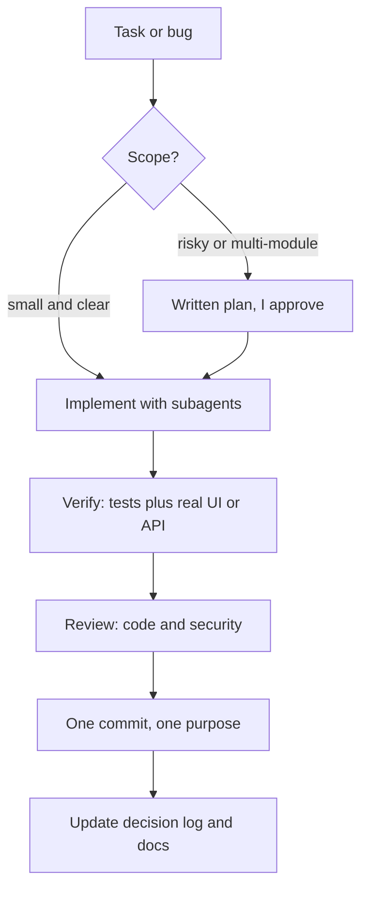

 

## 👋 About me

- 💻 **Full-stack developer**: I build web and backend systems end to end, from API design and database to UI and Docker deployment
- 🎓 Final-year (4th year) student at **Ho Chi Minh City University of Technology (HCMUT)**, working towards degrees in both **Cybersecurity** and **Computer Science**
- 🛡️ My security background shapes how I code: authentication, access control and logging from day one
- 🤖 I build software **with AI agents** as part of a structured, human-approved workflow (see below)
- 🔭 Currently working on my graduation project **Farmery**, a traceable agricultural e-commerce platform
- 🎮 Outside of work I'm interested in **game development** and in **teaching programming**
- 📫 Open to collaborating and to talking about software: reach me by email or LinkedIn

## 💼 Experience

**Full-stack Developer Intern** · MedbelAI · *Jun 2026 – present*

- Build features across the stack: web UI, API services, authentication and role-based access control, containerized deployment
- Work in a monorepo with a pull request and code review workflow, backed by written decision logs
- Apply the AI-agent workflow described below in day-to-day delivery
- **Next:** moving to a full-time position with added responsibility for leading a team of 4

## 🧰 Tech stack

| Area | What I use |
|---|---|
| Languages | TypeScript, JavaScript, Python, PHP, C++, PowerShell, Bash |
| Web / API | React, Node.js, FastAPI, custom MVC in PHP, MySQL |
| DevOps | Docker, Linux, pnpm + Turborepo monorepos, Git workflow with pull requests |
| Security | OWASP Top 10, Wazuh (SIEM/XDR), MITRE ATT&CK mapping, Kali Linux |
| AI-assisted dev | Claude Code, project instruction files, specialized subagents, browser automation for UI checks |
| Docs | LaTeX reports, Markdown, decision logs |

## 🚀 Featured projects

| Project | Stack | What it is |
|---|---|---|
| [**Farmery**](https://github.com/nghianguyenhk0981/DACN_DATN_26) graduation project |     | Agricultural e-commerce with product traceability. Monorepo with shop, admin and API apps, a shared contract package, and the LaTeX thesis report. |
| [**DADN252**](https://github.com/nghianguyenhk0981/DADN252) smart waste bin |      | AI image classification, real-time MQTT messaging and a FastAPI backend. |
| [**WEB252 (TechSaaS)**](https://github.com/nghianguyenhk0981/WEB252) corporate site and shop |   | Built on a hand-written MVC framework: products, cart, orders, news and comments. |
| [**OWASP Learning Hub**](https://github.com/nghianguyenhk0981/owasp-learning-hub) learn by hacking |   | Lessons, quizzes and an in-browser "Hack It" sandbox, with unit tests. |
| [**Small-Scale SOC**](https://github.com/nghianguyenhk0981/Small-Scale-SOC-Implementation) security lab |    | Detects SSH/RDP brute force, monitors file integrity and blocks attackers automatically. |

> The projects above are forks. Original repositories and full commit history are under [@NghiaNguyenhk2005](https://github.com/NghiaNguyenhk2005).

## 🤖 Engineering with AI agents

I use AI agents (mainly Claude Code) every day, and I treat them like a team member that needs clear rules, scoped responsibilities and review. The goal is faster delivery without losing control of quality, security or the codebase.

| Practice | How I run it |
|---|---|
| 📜 **Rules as code** | Project and global instruction files define conventions, git etiquette and what the agent must never do, so behavior is consistent across sessions and projects. |
| 🗺️ **Plan before editing** | Changes that touch several modules, alter a schema, are hard to undo or affect operations get a written plan that I approve first. Small, well-scoped fixes go straight through. |
| 🧩 **Specialized subagents** | Separate agents for UI/UX, infrastructure, data modeling and documentation, each with minimal tools and a deliberately chosen model: a fast one for lookups, a stronger one for judgment. |
| ♻️ **Reuse before building** | I use existing review, verify and security-review skills before writing a custom agent, and only create one when the need is recurring and clearly bounded. |
| 🔍 **Systematic debugging** | Root cause first: one hypothesis, one small change. After three failed fixes the agent must stop and re-analyze instead of trial and error. |
| ✅ **Honest verification** | Every claim lists each case and how it was checked (real UI or API versus mocks). UI is verified in a real browser with automation, not just type checks. |
| 📚 **Living documentation** | Append-only decision log, open-notes file, release notes and a file index. Agents read them before work and update them after, so context survives between sessions. |
| 🔒 **Guardrails** | The agent commits or pushes only when asked, never force-pushes, skips hooks or merges PRs, keeps credentials outside the repo, and asks before destructive actions. A stop hook flags leftover processes. |
| 🧹 **Context hygiene** | Broad exploration goes to subagents, related requests are batched, and each task starts in a fresh session to keep the context small. |

## 📈 Activity

